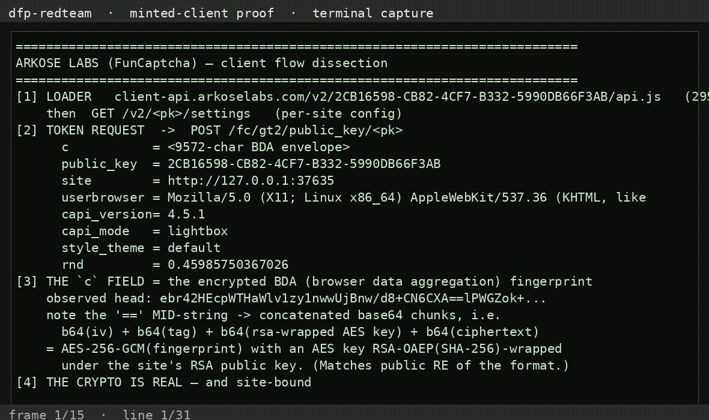

# dfp-redteam-arkose — Arkose Labs (FunCaptcha)

Authorized dissection of Arkose Labs **FunCaptcha**'s client using a production
site's **public** key (Twitter's `2CB16598-CB82-4CF7-B332-5990DB66F3AB`, from
public analyses). Only a public widget load; no challenge solved, no token
forged. Detail: [`ARKOSE_BREAK_2026_11_02.md`](ARKOSE_BREAK_2026_11_02.md).

---

## What we found

- **Loader**: `client-api.arkoselabs.com/v2/<pk>/api.js` (295 KB, proprietary,
  webpack) → `GET /v2/<pk>/settings`.
- **Token request**: `POST /fc/gt2/public_key/<pk>` with fields `c, public_key,
  site, userbrowser, capi_version (=4.5.1), capi_mode, style_theme, rnd`.
- **`c` = the encrypted BDA** (browser data aggregation fingerprint), ~9.6 KB.
  The captured head `…XA==lPWG…` shows an **`==` mid-string** — the signature of
  concatenated base64 chunks: `b64(iv) + b64(tag) + b64(rsa-wrapped key) +
  b64(ciphertext)`, i.e. **AES-256-GCM(fingerprint)** with the AES key
  **RSA-OAEP(SHA-256)-wrapped** under the site's RSA public key (matches the
  public reverse-engineering of the format).
- **Site-bound**: posting to a key from a non-matching origin returned
  `400 {"error":"DENIED ACCESS"}` — the per-site binding works.

## Status

- 🟢 Read flow / envelope structure: loader, settings, `gt2` POST, `c` layout
- 🔴 Read the BDA plaintext: genuine **RSA-OAEP + AES-GCM** envelope — not broken
- 🔴 Forge `c` / mint token: needs the **per-site RSA public key**, which is
  reconstructed at runtime inside the obfuscated api.js VM (not a static string)
- The per-site binding rejects cross-site use

## Recorded demo

<video src="assets/demo-arkose.mp4" width="720" controls></video>

## Artifacts & scripts

- [`artifacts/cap-result.json`](artifacts/cap-result.json) — full token-request flow + envelope
- `scripts/ark-capture.mjs` — drive the real api.js + capture the encrypted POST
- `scripts/demo-arkose.py` — print the analysis

## Honest caveats

- Used a **public key only**; no challenge was solved and no valid token was
  obtained (our cross-site POST was correctly **denied**).
- The BDA envelope was **characterised, not decrypted**; forging would require the
  per-site RSA public key from the obfuscated VM (public solvers do this; we
  did not).
- Good-vs-bad framing: a **good** design — real client crypto sealed to a server
  key + a challenge VM + per-site binding.

## Wire / tamper / mint (what can we actually do?)

- **See the wire?** No. `c` is the **encrypted BDA** (RSA-OAEP + AES-GCM); we
  characterised the concatenated-base64 envelope but **not** the plaintext.
- **Tamper?** We resubmitted the token request: original, a **flipped-byte `c`**,
  and a **garbage `c`** — **all three → `400 {"error":"DENIED ACCESS"}`**
  (`artifacts/tamper-result.json`). The per-site binding blocks our origin, so
  BDA validation can't be isolated — but nothing we tampered was accepted.
- **Mint?** No. A valid `c` requires the **per-site RSA public key** (reconstructed
  at runtime inside the obfuscated VM); the token is server-issued.
