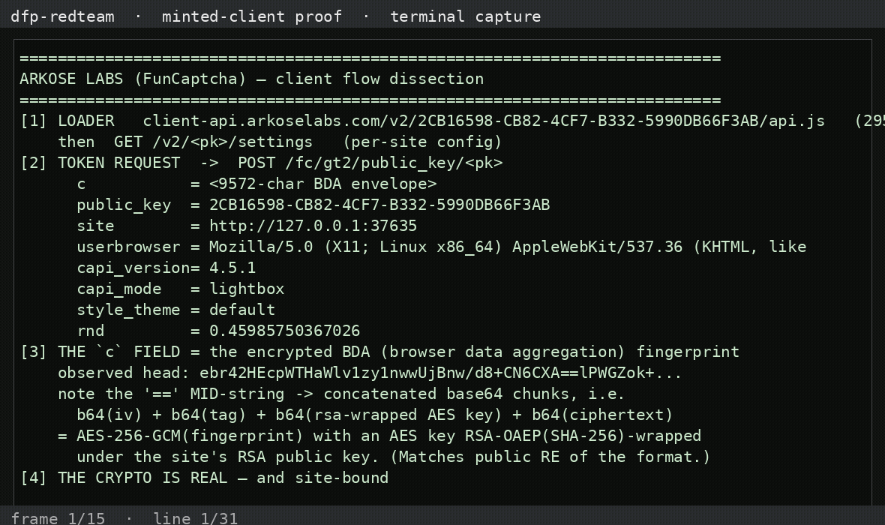

# dfp-redteam-arkose — Arkose Labs (FunCaptcha)

Authorized dissection of Arkose Labs **FunCaptcha**'s client using a production
site's **public** key (Twitter's `2CB16598-CB82-4CF7-B332-5990DB66F3AB`, from
public analyses). Only a public widget load; no challenge solved, no token
forged.

- Write-up: [`ARKOSE_BREAK_2026_11_02.md`](ARKOSE_BREAK_2026_11_02.md)
- **Round 2 (2026-11-13): the BDA plaintext + every collected field →
  [`FIELD_CATALOG.md`](FIELD_CATALOG.md)**

---

## What we found

- **Loader**: `client-api.arkoselabs.com/v2/<pk>/api.js` (295 KB, proprietary,
  webpack) → `GET /v2/<pk>/settings`.
- **Token request**: `POST /fc/gt2/public_key/<pk>` with fields `c, public_key,
  site, userbrowser, capi_version (=4.5.1), capi_mode, style_theme, rnd`.
- **`c` = the encrypted BDA** (browser data aggregation fingerprint), ~9.6 KB.
  The captured head `…XA==lPWG…` shows an **`==` mid-string** — the signature of
  concatenated base64 chunks: `b64(iv) + b64(tag) + b64(rsa-wrapped key) +
  b64(ciphertext)`, i.e. **AES-256-GCM(fingerprint)** with the AES key
  **RSA-OAEP(SHA-256)-wrapped** under the site's RSA public key (matches the
  public reverse-engineering of the format).
- **Site-bound**: posting to a key from a non-matching origin returned
  `400 {"error":"DENIED ACCESS"}` — the per-site binding works.

## Round 2 — read the plaintext, catalog the collection

Hooking the **serialization** boundary (`TextEncoder.prototype.encode`) instead
of the crypto boundary yields the full BDA before encryption:

- 7 070-byte JSON: 91 `enhanced_fp` entries + 23 `fe` fields + `f`, `n`, `wh`,
  `ife_hash`, `jsbd`.
- Envelope split confirmed: `b64(iv‖tag) ‖ b64(RSA-OAEP key) ‖ b64(AES-GCM ct)`
  = 28 / 256 / 7 074 bytes.
- **Integrity layer reverse-engineered**: custom MurmurHash3-128 variant;
  `f = H(fe values, 0)`, `ife_hash = H(fe, 38)`, and
  `wh = H(window own keys, 420) ‖ H(proto-chain keys, 420)`. `wh` is a
  **tamper detector** — adding a global or deleting a built-in changes it.
- **Field attribution by perturbation**: 47 variants patch one browser surface,
  capture the BDA, diff. See `FIELD_CATALOG.md` for the field→API mapping.
- **Frame-tree recon**: `location.ancestorOrigins` + parent chain leak the
  embedding origin chain (`window__ancestor_origins/tree_index/tree_structure`).
- **Not trackable**: `lfasdgs` looks like a device UUID but is a hard-coded
  bundle constant; the only per-load ID is the metrics session id (`4b4b269e68`).
- **Plaintext side channel**: `POST /metrics/ui` reports platform, language,
  connection class, origin/path, timings and the exact error, unencrypted.

## Status

- 🟢 Read flow / envelope structure: loader, settings, `gt2` POST, `c` layout
- 🟢 Read the BDA plaintext (client-side serialization boundary) — see `FIELD_CATALOG.md`
- 🔴 Decrypt `c` without the client / without the per-site RSA private key
- 🔴 Forge `c` / mint token: needs the **per-site RSA public key**, which is
  reconstructed at runtime inside the obfuscated api.js VM (not a static string)
- 🟢 Per-site binding rejects cross-site use (`400 DENIED ACCESS`)
- 🟢 Client-side tamper/instrumentation is detectable via `wh` before decryption

## Recorded demo

<video src="assets/demo-arkose.mp4" width="720" controls></video>

## Artifacts & scripts

- [`artifacts/cap-result.json`](artifacts/cap-result.json) — full token-request flow + envelope
- [`artifacts/bda-plaintext.json`](artifacts/bda-plaintext.json) — decrypted-at-source BDA (7 070 B)
- `artifacts/hook-result.json` — every hook hit: WebCrypto calls, fetch/XHR bodies, browser-API reads
- `artifacts/bda-diff-batch{1,2,3}.json` — perturbation runs (field attribution)
- `scripts/ark-capture.mjs` — drive the real api.js + capture the encrypted POST
- `scripts/ark-hook.mjs` — hook WebCrypto/serialization/network/browser APIs, dump the BDA
- `scripts/ark-diff.mjs`, `scripts/ark-diff2.mjs`, `scripts/ark-probe3.mjs` — perturbation harnesses
- `scripts/ark-persist.mjs` — identifier-stability checks
- `scripts/demo-arkose.py` — print the analysis

## Honest caveats

- Used a **public key only**; no challenge was solved and no valid token was
  obtained (our cross-site POST was correctly **denied**).
- The BDA was read **in the client, at the serialization boundary** — not
  decrypted, and not forged. Forging would require the per-site RSA public key
  from the obfuscated VM (public solvers do this; we did not).
- Unnamed fields are marked † in the catalog rather than guessed.
- Good-vs-bad framing: a **good** design — real client crypto sealed to a server
  key + a challenge VM + per-site binding.

## Wire / tamper / mint (what can we actually do?)

- **See the wire?** Yes, **client-side, before encryption** (Round 2). `c` is
  still RSA-OAEP + AES-GCM on the wire, and we cannot decrypt it without the
  site's private key — but the plaintext necessarily exists in the page, and
  hooking `TextEncoder.encode` reads it. Full catalog in `FIELD_CATALOG.md`.
- **Tamper?** We resubmitted the token request: original, a **flipped-byte `c`**,
  and a **garbage `c`** — **all three → `400 {"error":"DENIED ACCESS"}`**
  (`artifacts/tamper-result.json`). The per-site binding blocks our origin, so
  BDA validation can't be isolated — but nothing we tampered was accepted.
- **Mint?** No. A valid `c` requires the **per-site RSA public key** (reconstructed
  at runtime inside the obfuscated VM); the token is server-issued.
